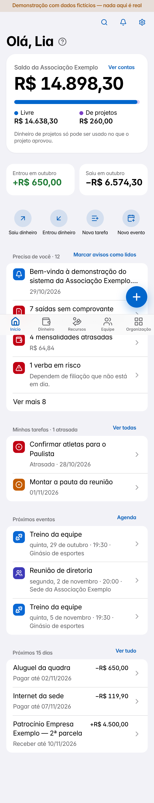
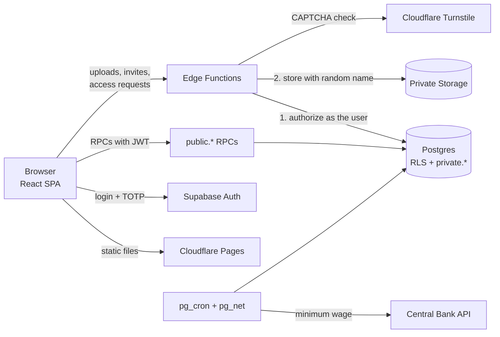

<div align="center">

# ERP for Associations

**A management system for small non-profit sports associations: money, members, board work and public accountability in one place, with every access rule decided on the server.**

[Features](#features) · [Run the demo](#run-the-demo) · [Security](#security-and-privacy) · [Tech stack](#tech-stack) · [Architecture](#architecture)

</div>

> [!NOTE]
> All names, numbers and records in this repository belong to a fictional "Associação Exemplo". The demo mode runs entirely in the browser with fake data: no keys, no backend.

<p align="center">
  
  
  
</p>

The user interface is in Brazilian Portuguese, since it was built for a Brazilian association. The code, tests and docs are in Portuguese too.

## Features

| Area | What it does |
|---|---|
| **Money** | Accounts and transactions with receipts (photo, PDF, NFC-e QR code, bank slip barcode, NF-e XML). Reimbursements, bills to pay and receive, bank reconciliation from OFX/CSV, yearly budget (planned × actual) and month-end closing. |
| **People** | Athletes and members, sports profile, ID photo (only with image consent), documents with expiry dates, privacy consents and a separate health area. Monthly fees as a percentage of the minimum wage, updated daily from the Central Bank's open API, plus Pix payment codes. |
| **Organization** | Calendar (month, week, list, .ics export), task board with checklists, comments, recurring tasks and templates, notices with read receipts, training attendance. |
| **Grants and projects** | Expected grants with rules, installments and required documents; projects with budget lines, pending items and accountability reports (PDF/CSV). |
| **Fundraising** | Sponsor pipeline, sponsor deliverables with photos, raffles and events, numbered donation receipts. |
| **Trips** | Team list, rooms, accessibility needs, cash advances and settlement, cost per athlete and per km. |
| **Governance** | Bylaws, certificates, terms of office, meetings with votes and minutes, accountant files, chart of accounts and trial balance. |
| **Assets and memberships** | Equipment loans and maintenance; federation memberships with fees and required documents. |
| **Analytics** | 3/6/12-month cash forecast, what-if scenarios, revenue concentration, unusual expenses, possible duplicates, late fees, PDF reports. |
| **Transparency** | A public page with aggregated numbers that the board reviews and publishes. No personal data. |
| **Access** | Email invitations, roles from the bylaws (a fiscal council role can only read and export), editable permission templates, access requests with CAPTCHA, full audit trail. |

### Interface

- **Mobile first.** Built for quick use on a phone (snap a receipt during a trip), with a sidebar and two columns on large screens.
- **Clean, app-like look.** Grouped lists on cards, bottom sheets for forms, segmented controls, the device's system font and line icons. Light and dark themes follow the device.
- **Reads documents on the device.** OCR of receipts, QR codes, bank slips and bank statements run in the browser, so the files never leave the phone just to be read. The results are only suggestions: the server validates everything again.
- **Accessible.** WCAG 2.2 AA: color contrast is checked by a unit test over the design tokens, and every screen is scanned with axe.
- **Works offline for new entries.** A transaction made without internet stays on the device and is sent later.

## Run the demo

Requires **Node.js 24** and **npm 11.10+** (the `.npmrc` uses `min-release-age`).

```bash
npm ci            # exact versions from package-lock.json, no install scripts
npm run dev:demo  # http://localhost:5173
```

Sign in with any email and a password of 4+ characters. The two-factor code is **123456**.

> [!IMPORTANT]
> The demo code is never shipped: the production build audit fails if it finds any demo data, a source map or a secret.

To run it for real, follow [`docs/deploy.md`](docs/deploy.md) (Supabase project, migrations, Auth, Edge Functions, scheduled jobs) and fill `.env.local` from [`.env.example`](.env.example) with **only** the project URL and the publishable key.

## Security and privacy

The browser asks; the server decides. When in doubt, the answer is no (fail closed).

- **Authorization in the database.** Row Level Security on every table, plus a restrictive policy that requires two-factor auth (`aal2`). The rules live in `private.*` functions (`SECURITY DEFINER`, empty `search_path`), reached only through `public.*` wrappers (`SECURITY INVOKER`). There are no direct writes: every change goes through an RPC that checks the person, module, action and scope, and writes to the audit trail.
- **Uploads only through an Edge Function.** File type is checked from the real bytes (not the extension), names are random, buckets are private, and size limits are enforced in the function and again in the database. Photos are re-encoded on the device, which strips GPS data.
- **No secrets on the client.** Only the publishable key ships. CSP, HSTS and other headers are generated with the build, and a script audits the real build output before release.
- **Money is append-only.** A closed month cannot change; corrections are reversals, with before/after in the audit log.
- **Health data** has its own area, needs a specific permission and a recorded consent, and every read is audited.
- **Supply chain.** Dependencies are installed from the lockfile with a 7-day quarantine on new versions and no install scripts; CI actions are pinned by SHA.

Threat model (STRIDE), access matrix, accepted risks and incident plan: [`docs/seguranca.md`](docs/seguranca.md). Data inventory, legal bases, retention and data-subject rights under Brazil's LGPD: [`docs/lgpd.md`](docs/lgpd.md).

## Tests

| Command | What it checks |
|---|---|
| `npm test` | 322 unit tests (money math, Pix BR Code, bank slip and NF-e parsing, OFX/CSV, file-type detection, CSP…) |
| `npm run test:db` | 352 tests against a **real Postgres**: RLS for each role, IDOR probes, fuzzing (fast-check), concurrency, and **mutation tests** that switch off each security control and expect a test to fail |
| `bash tests/e2e/rodar.sh` | 11 browser runs (Playwright + axe) served with the real security headers |
| `npm run verificar` | Types → all tests → build → build audit → secret scan |

The database tests need a throwaway Postgres 16, outside the project folder:

```bash
docker run -d --name erp-pgtest -p 54329:5432 -e POSTGRES_HOST_AUTH_METHOD=trust postgres:16
PGHOST=localhost npm run test:db
```

## Tech stack

| Layer | Tools |
|---|---|
| Frontend | React 19, TypeScript, Vite, Tailwind CSS v4, shadcn/ui (Radix), TanStack Query, Motion |
| Backend | Supabase: Postgres + RLS, Auth (password + TOTP), private Storage, Edge Functions (Deno), pg_cron, pg_net |
| Hosting | Cloudflare Pages (static site + security headers), Cloudflare Turnstile (CAPTCHA) |
| Testing | Vitest, fast-check, Playwright, axe-core |

## Architecture



The full diagram, including the upload and invitation flows step by step, is in [`docs/arquitetura.drawio`](docs/arquitetura.drawio) (open it at [app.diagrams.net](https://app.diagrams.net)). Each design decision and its reasons are recorded as ADRs in [`docs/adr/`](docs/adr/README.md).

```
src/
  app/          session, app shell and routes
  telas/        one folder per area (money, people, calendar, tasks, grants, projects…)
  components/   shadcn/ui components and app building blocks
  dados/        data source (Supabase or demo), types and queries
  lib/          money, dates, fees, Pix, QR, bank slip, NF-e, receipts, statements
supabase/
  migrations/   numbered, applied in order, never edited after being applied
  functions/    Edge Functions and their shared, Node-testable logic
tests/          database, unit and browser tests
docs/           security, privacy, deployment, architecture and ADRs
```

## License

© Lucas Frois Vasconcellos. **All rights reserved.** No license is granted: you may not use, copy, modify or distribute this code without written permission.
